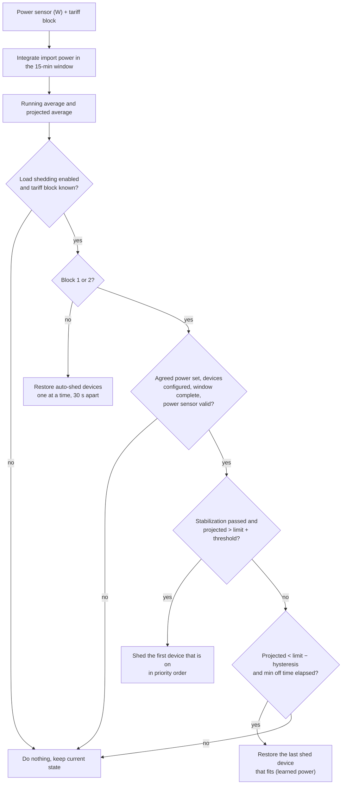

# Namudri Elektro

Home Assistant custom integration for Slovenian **omrežnina**: 15-minute power averages, end-of-window projection, configurable *dogovorjena moč* (agreed power) per tariff block, and built-in **load shedding** in tariff blocks 1–2.

The projection is calculated inside the integration (one source of truth), so you do not need a template sensor or the `power_average` integration.

## Requirements

Install separately (e.g. via HACS):

- [Elektro Network Tariff](https://github.com/frlequ/home-assistant-network-tariff) — provides the current block 1–5.
- A **power sensor in W** (e.g. Shelly 3EM total power). Export (≤ 0 W) counts as 0 W.

Home Assistant **2024.11.0** or newer.

## Installation

### HACS (custom repository)

1. HACS → ⋮ → **Custom repositories**.
2. Add `https://github.com/JernejHren/Namudri-Elektro`, category **Integration**.
3. Install **Namudri Elektro** and restart Home Assistant.

### Manual

Copy `custom_components/namudri_elektro` into your Home Assistant `custom_components` folder and restart.

### Removal

1. **Settings → Devices & services → Namudri Elektro → ⋮ → Delete.** Devices that were shed are **not** switched back on automatically when you delete the integration — use the **Load shedding** switch (off = restore everything) or `namudri_elektro.restore_all` first.
2. HACS: remove the repository; manual install: delete `custom_components/namudri_elektro` and restart.
3. Optional: delete `.storage/namudri_elektro.shed_state_<entry id>` (the saved shed list).

### Setup

1. **Settings → Devices & services → Add integration → Namudri Elektro.**
2. Pick the power sensor and the tariff block sensor.
3. Optionally pick the devices to shed, in priority order (first = shed first), and the phones to notify on every shed/restore. Notification targets are chosen from a list of the notify services registered in your Home Assistant (mobile apps first, e.g. `notify.mobile_app_phone`). Leave empty for monitoring only. This can be changed later via **Configure**; the name and the two source sensors can also be changed with **⋮ → Reconfigure** on the integration entry.
4. Set the agreed power **T1–T5 in kW**. The default is **0 = not set**: until you set a block, its headroom and over-limit are unknown and nothing is shed in that block.
5. Adjust the shed tuning numbers if needed and switch **Load shedding** on.

## How it works

Billing windows are fixed at **:00, :15, :30, :45** (900 s).

1. Import power is integrated over the current window.
2. **Running average** = energy so far / elapsed time.
3. **Projected average** = (energy so far + current power × remaining time) / 900 s.
4. **Headroom** = agreed power of the current block − projected average.

The power assumed for the rest of the window is the average of the last 30 s (**Power smoothing**, 0 = latest value), so a short spike is not extrapolated over minutes.

If Home Assistant starts or reloads in the middle of a window, the energy before that moment is unknown and is estimated with the current power. Such a window is flagged `window_complete: false` (attribute of the projected power sensor) and the controller waits for the next window before acting.



## Load shedding (blocks 1–2)

When the projection is above agreed power + threshold, and at least **Projection stabilization** seconds of the window have passed (default 300 s = 5 min; early in a window the projection is too noisy):

1. Turn off the next device that is **on**, in priority order (first priority first).
2. Remember its previous state (climate HVAC mode / setpoint, water heater operation mode) and measure how much the total power dropped — this is the device's power, remembered for the restore decision.
3. Only restore devices **this integration** turned off.
4. Manual offs stay off; if you turn a shed device back on, it leaves the auto-shed list.
5. Restore when the projection is below agreed power − hysteresis, the minimum off time (default 15 min) has elapsed **and the device's learned power still fits** below that line — one device at a time, 30 s apart.
6. Outside blocks 1–2, auto-shed devices are restored (also one by one).
7. If the tariff sensor is unavailable, nothing is shed or restored until it is back.
8. If the power sensor is unavailable or its state is older than **Sensor timeout** (default 120 s), nothing is shed until it is back; you get a notification after a minute.
9. A device never stays off longer than **Maximum off time** (default 120 min, 0 = no cap): it is restored whatever the projection, tariff or sensor state is. Use it as a safety net for heating and hot water.
10. Slow devices (e.g. cloud climate) get up to 10 s to report `off`; once `turn_off` was accepted the device is recorded as shed, so it is always restored later.

Supported device domains: `switch`, `climate`, `water_heater`. The master switch **Load shedding** disables the controller and restores everything. The shed list is persisted and survives restarts.

## Entities

Entity IDs below assume the default device name *Namudri Elektro* and an English Home Assistant (e.g. `sensor.namudri_elektro_headroom`). Home Assistant derives entity IDs from the entity names in the language it runs in when the entity is first added, so a Slovenian installation gets Slovenian IDs; entities that already exist keep their ID.

| Entity | Description |
|--------|-------------|
| `sensor.*_projected_15_min_power` | Projected end-of-window average (W); attributes include `window_complete` |
| `sensor.*_running_15_min_average` | Running average (W) |
| `sensor.*_completed_15_min_average` | Last completed window (W) |
| `sensor.*_agreed_power_current_block` | Agreed limit for the current block (W), unknown if not set |
| `sensor.*_headroom` | Agreed power − projection (W), unknown if the limit is unknown |
| `sensor.*_tariff_block` | Block 1–5 (diagnostic) |
| `sensor.*_shed_device_count` | How many devices are auto-shed (diagnostic, **disabled by default**) |
| `binary_sensor.*_over_agreed_power` | Projection above agreed power |
| `binary_sensor.*_shedding_active` | Auto-shed list is not empty |
| `switch.*_load_shedding` | Master enable |
| `number.*_agreed_power_t1` … `t5` | Dogovorjena moč (**kW**), configuration category |
| `number.*_shed_threshold` | W above the limit before shedding |
| `number.*_restore_hysteresis` | W below the limit before restoring |
| `number.*_minimum_off_time` | Minutes a shed device stays off at least |
| `number.*_maximum_off_time` | Minutes after which a shed device is restored whatever happens (0 = no cap) |
| `number.*_projection_stabilization` | No shedding during the first N seconds of a window (default 300) |
| `number.*_power_smoothing` | Seconds over which the power for the projection is averaged (0 = off) |
| `number.*_sensor_timeout` | Seconds after which a power sensor state counts as stale (0 = no check) |

Entities become **unavailable** while the sensor they depend on is unavailable (the projection, running average, headroom and over-limit need the power sensor; the tariff block, agreed power, headroom and over-limit need the tariff sensor). A limit that is simply not set is shown as *unknown*. Both sensors being gone is logged once, and again when they are back. The number entities and the switch are always available.

The data is **not polled**: the integration listens to the two source sensors and recalculates every 5 s, all locally.

## Repairs

Two situations are shown under **Settings → System → Repairs** and disappear by themselves when fixed:

- **Power sensor not available**: the power sensor has been unavailable or stale for more than 10 minutes (nothing is shed meanwhile).
- **Agreed power is not set**: load shedding is on and devices are chosen, but T1 and/or T2 is 0, so nothing can be shed in that block.

Neither is raised while **Load shedding** is off.

## Use cases

- Keep a household under the agreed power in the expensive blocks 1–2 by pausing a boiler, a heat pump or a car charger for a few minutes.
- Show the remaining headroom and a warning before the 15-minute average exceeds the agreed power.
- Check later whether the agreed power per block is set sensibly (compare with the completed windows).

## Known limitations

- The result can only be as accurate as the power sensor. Compare the 15-minute values with your meter data (distributor portal) — with three phases and solar production the sum of the phases is not always what the meter bills.
- Only `switch`, `climate` and `water_heater` entities can be shed, and only in tariff blocks 1 and 2.
- The power a device draws is measured from the drop of the total power 15–120 s after the shed; another load switching at the same time distorts the estimate.
- If another automation switches a shed device back on, Namudri takes it off its list and does not shed it again until the projection exceeds the limit again.
- The first 5 minutes of a window (configurable) never shed anything, and neither does a window that was started by a restart in its middle.
- There is no re-authentication or discovery: nothing here needs a login and there are no devices to find.

## Troubleshooting

- **Entities unavailable**: check the power sensor (is it updating? the *Sensor timeout* is 120 s by default) and the tariff sensor (it must report 1–5). The log tells which of them is missing.
- **Integration stays in "retrying"**: one of the two sensors does not exist (yet). Check the entity IDs under **Configure**.
- **Nothing is shed**: is **Load shedding** on, is the agreed power of the current block set (not 0), are devices configured, is it block 1 or 2, and is the window complete (`window_complete` attribute)?
- **Download diagnostics** (device page → ⋮) when reporting a problem; notification targets are redacted.

## Lovelace

A ready-to-use example (entities card, gauge and an alert) is in [`examples/lovelace.yaml`](examples/lovelace.yaml). Replace the entity IDs if you renamed the device. The tariff block itself can also be shown with the card from the [Elektro Network Tariff](https://github.com/frlequ/home-assistant-network-tariff) project.

## Services

- `namudri_elektro.restore_all` — restore all auto-shed devices at once (optional `entry_id`).
- `namudri_elektro.force_shed` — shed the next device in priority order now; ignores the projection, needs load shedding enabled (optional `entry_id`).

## Development

```bash
python3 -m venv venv && . venv/bin/activate
pip install -r requirements_test.txt
pytest --cov=custom_components.namudri_elektro
mypy --config-file mypy.ini custom_components/namudri_elektro
```

The tests use [`pytest-homeassistant-custom-component`](https://github.com/MatthewFlamm/pytest-homeassistant-custom-component) (a real Home Assistant), plus a few fast tests of the control logic against a small stub.

The same checks run on GitHub for every pull request ([`.github/workflows/ci.yml`](.github/workflows/ci.yml)): tests, `mypy --strict`, hassfest and the HACS validation, plus a weekly run to catch breakage from new Home Assistant releases.

### Quality scale

The integration follows the [Home Assistant integration quality scale](https://contributors.home-assistant.io/core/quality-scale/); [`quality_scale.yaml`](custom_components/namudri_elektro/quality_scale.yaml) lists the status of every rule, and every rule of Bronze, Silver, Gold and Platinum is done or exempt with a reason. As a custom integration it has no official tier, so this is a self-assessment. `mypy --strict` passes on the whole component.

### Brand images

The icon and logo (light and dark, 1x and 2x) are in [`custom_components/namudri_elektro/brand`](custom_components/namudri_elektro/brand); Home Assistant **2026.3** and newer uses them directly. The SVG sources and the render script are in [`assets/brand`](assets/brand) (`python assets/brand/render.py`, needs Playwright with Chromium). Older versions would need the images in the [home-assistant/brands](https://github.com/home-assistant/brands) repository.

## License

Apache-2.0
