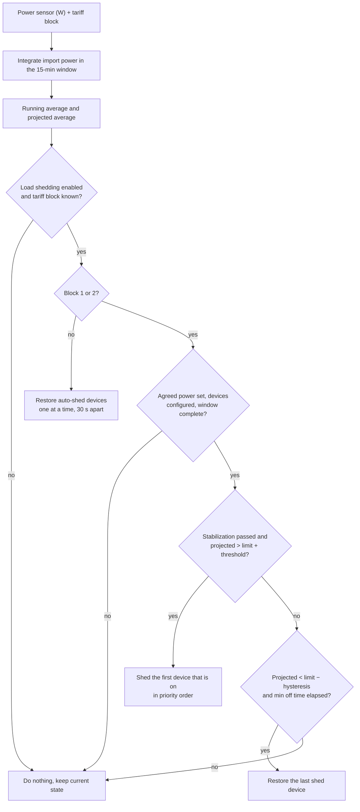

# Namudri Elektro

Home Assistant custom integration for Slovenian **omrežnina**: 15-minute power averages, end-of-window projection, configurable *dogovorjena moč* (agreed power) per tariff block, and built-in **load shedding** in tariff blocks 1–2.

The projection is calculated inside the integration (one source of truth), so you do not need a template sensor or the `power_average` integration.

## Requirements

Install separately (e.g. via HACS):

- [Elektro Network Tariff](https://github.com/frlequ/home-assistant-network-tariff) — provides the current block 1–5.
- A **power sensor in W** (e.g. Shelly 3EM total power). Export (≤ 0 W) counts as 0 W.

Home Assistant **2024.11.0** or newer.

## Installation

### HACS (custom repository)

1. HACS → ⋮ → **Custom repositories**.
2. Add `https://github.com/JernejHren/Namudri-Elektro`, category **Integration**.
3. Install **Namudri Elektro** and restart Home Assistant.

### Manual

Copy `custom_components/namudri_elektro` into your Home Assistant `custom_components` folder and restart.

### Setup

1. **Settings → Devices & services → Add integration → Namudri Elektro.**
2. Pick the power sensor and the tariff block sensor.
3. Optionally pick the devices to shed, in priority order (first = shed first), and the phones to notify on every shed/restore. Notification targets are chosen from a list of the notify services registered in your Home Assistant (mobile apps first, e.g. `notify.mobile_app_phone`). Leave empty for monitoring only. This can be changed later via **Configure**.
4. Set the agreed power **T1–T5 in kW**. The default is **0 = not set**: until you set a block, its headroom and over-limit are unknown and nothing is shed in that block.
5. Adjust the shed tuning numbers if needed and switch **Load shedding** on.

## How it works

Billing windows are fixed at **:00, :15, :30, :45** (900 s).

1. Import power is integrated over the current window.
2. **Running average** = energy so far / elapsed time.
3. **Projected average** = (energy so far + current power × remaining time) / 900 s.
4. **Headroom** = agreed power of the current block − projected average.

If Home Assistant starts or reloads in the middle of a window, the energy before that moment is unknown and is estimated with the current power. Such a window is flagged `window_complete: false` (attribute of the projected power sensor) and the controller waits for the next window before acting.



## Load shedding (blocks 1–2)

When the projection is above agreed power + threshold (after the stabilization delay):

1. Turn off the next device that is **on**, in priority order (first priority first).
2. Remember its previous state (climate HVAC mode / setpoint, water heater operation mode).
3. Only restore devices **this integration** turned off.
4. Manual offs stay off; if you turn a shed device back on, it leaves the auto-shed list.
5. Restore when the projection is below agreed power − hysteresis and the minimum off time (default 15 min) has elapsed — **one device at a time**, 30 s apart.
6. Outside blocks 1–2, auto-shed devices are restored (also one by one).
7. If the tariff sensor is unavailable, nothing is shed or restored until it is back.

Supported device domains: `switch`, `climate`, `water_heater`. The master switch **Load shedding** disables the controller and restores everything. The shed list is persisted and survives restarts.

## Entities

Entity IDs below assume the default device name *Namudri Elektro* (e.g. `sensor.namudri_elektro_headroom`).

| Entity | Description |
|--------|-------------|
| `sensor.*_projected_15_min_power` | Projected end-of-window average (W); attributes include `window_complete` |
| `sensor.*_running_15_min_average` | Running average (W) |
| `sensor.*_completed_15_min_average` | Last completed window (W) |
| `sensor.*_agreed_power_current_block` | Agreed limit for the current block (W), unknown if not set |
| `sensor.*_headroom` | Agreed power − projection (W), unknown if the limit is unknown |
| `sensor.*_tariff_block` | Block 1–5 |
| `sensor.*_shed_device_count` | How many devices are auto-shed |
| `binary_sensor.*_over_agreed_power` | Projection above agreed power |
| `binary_sensor.*_shedding_active` | Auto-shed list is not empty |
| `switch.*_load_shedding` | Master enable |
| `number.*_agreed_power_t1` … `t5` | Dogovorjena moč (**kW**) |
| `number.*_shed_threshold` | W above the limit before shedding |
| `number.*_restore_hysteresis` | W below the limit before restoring |
| `number.*_minimum_off_time` | Minutes a shed device stays off |
| `number.*_projection_stabilization` | Seconds into the window before shedding |

## Lovelace

A ready-to-use example (entities card, gauge and an alert) is in [`examples/lovelace.yaml`](examples/lovelace.yaml). Replace the entity IDs if you renamed the device. The tariff block itself can also be shown with the card from the [Elektro Network Tariff](https://github.com/frlequ/home-assistant-network-tariff) project.

## Services

- `namudri_elektro.restore_all` — restore all auto-shed devices at once (optional `entry_id`).
- `namudri_elektro.force_shed` — shed the next device in priority order now; ignores the projection, needs load shedding enabled (optional `entry_id`).

## Development

```bash
pip install pytest
python -m pytest
```

The tests run without Home Assistant (a minimal stub is included).

## License

Apache-2.0
